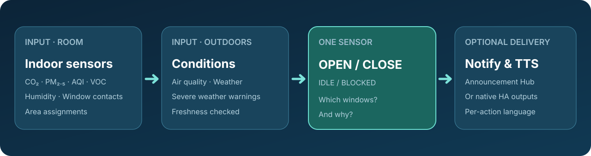
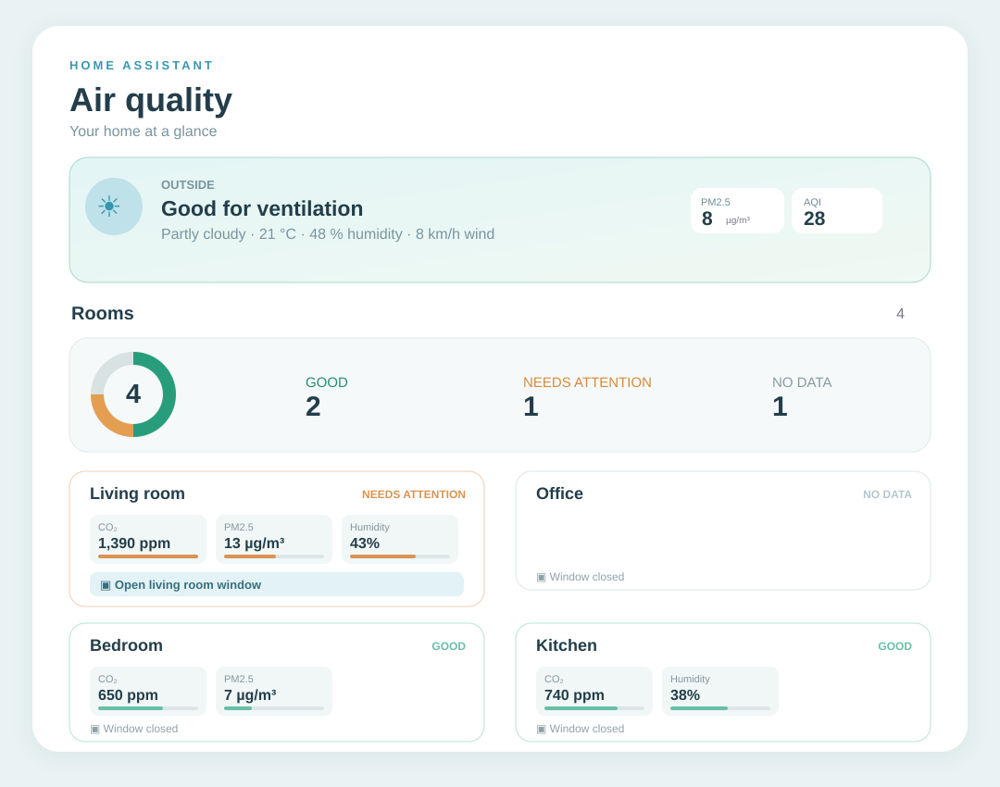
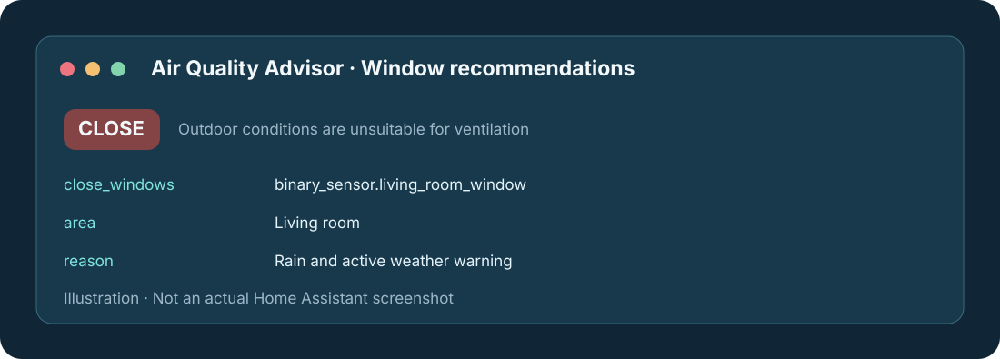

<p align="center">
  
</p>

<p align="center">
  <a href="https://ko-fi.com/chreece"></a>
</p>

<p align="center">
  <a href="https://github.com/Chreece/HA-Air-Quality-Advisor/releases"></a>
  <a href="https://github.com/Chreece/HA-Air-Quality-Advisor/actions/workflows/validate.yml"></a>
  <a href="https://www.hacs.xyz/"></a>
  <a href="https://github.com/Chreece/HA-Air-Quality-Advisor/blob/main/LICENSE"></a>
</p>

<p align="center">
  <a href="https://my.home-assistant.io/redirect/hacs_repository/?owner=Chreece&repository=HA-Air-Quality-Advisor&category=integration">
    
  </a>
</p>

# Air Quality Advisor for Home Assistant

**One recommendation entity and an optional visual dashboard card for all the rooms you select.** It compares indoor CO₂, AQI, particles, VOCs and humidity against outdoor air quality, current weather and selected weather-warning entities, then recommends **which windows to open or close and why**. Announcements are entirely optional.

> This project is an advisor, **not an automatic window actuator**, medical device, emergency warning system, or authoritative weather alert. It never controls covers. Outdoor warnings and uncertain conditions are intentionally treated as blockers.

<p align="center"></p>

## What it provides

- A single `sensor.air_quality_advisor_window_recommendations` (actual entity ID may vary with user settings). States: `open`, `close`, `idle`, `blocked`.
- Attributes: `open_windows`, `close_windows`, structured `recommendations` with windows, room/area, sensor reason, value and localised message, `outside_blockers`, `diagnostics`, `outdoor_safe`, `announcement_hub_available`.
- Event-driven updates and periodic 5-minute freshness checks. No external APIs, daemons, cloud credentials or Home Assistant tokens. Uses existing entities only.
- A guided four-step setup. Indoor measurements and window contacts are automatically discovered from each selected area's HA entity/device registry assignments. Configurable thresholds are tucked into **Configure → Advanced thresholds**.
- Optional room-aware [Announcement Hub](https://github.com/Chreece/HA-Announcement-Hub) output (`notify.announcement_hub`), **or** direct `notify.send_message` and `tts.speak` via supported entities. Not installing Announcement Hub does not affect the recommendation sensor.
- Auto notifications/TTS can each be enabled or disabled independently. Open announcements wait 90 seconds for conditions to stay stable; close announcements are immediate. Repeated open recommendations have a 15-minute cooldown during the current HA process. New urgent close recommendations are not suppressed by that cooldown, even if the same window was reopened. No notification is generated on every unchanged sensor reading.
- Manual `air_quality_advisor.announce` action, with independent **English, German, Greek, French or Spanish** language selection every time.
- A responsive **Air Quality Advisor dashboard card**: safe/attention/unknown room counts, current outdoor weather and pollution, threshold meters, window states, and room-specific advice. Card text follows your **Home Assistant user language**, independently of voice/notification language.

## Installation

### HACS (after publishing the repository)

1. In HACS, open **Custom repositories**; enter `https://github.com/Chreece/HA-Air-Quality-Advisor` and choose **Integration**.
2. Install **Air Quality Advisor**, restart Home Assistant and add it under **Settings → Devices & services → Add integration**. The dashboard card is bundled and registered automatically when Home Assistant starts; no separate HACS frontend repository or copy to `www` is required.
3. No YAML configuration is required. After updating from a version that was classified as a Helper, **restart Home Assistant** so the new manifest type takes effect. The existing configuration and entity ID are kept; the integration should now appear under **Settings → Devices & services → Integrations** instead of being categorized under Helpers.

### Manual

Copy `custom_components/air_quality_advisor/` to `<your Home Assistant config>/custom_components/air_quality_advisor/`, restart HA, then add the integration from the UI. Alternatively, from the extracted repository run:

```bash
HA_CONFIG=/path/to/homeassistant/config bash ./install.sh
```

The installer writes **only** the integration directory, makes a rollback backup of an older installation and does not restart HA or end your SSH session.

## Guided configuration

1. **Window sensor exclusions — editable multiselect.** Every Window-class `binary_sensor` is listed with its name, area and entity ID. Likely *virtual or auxiliary window statuses*—for example open-window detection from a thermostat/TRV, diagnostic entities or explicit detection labels—are marked ⚠ and **preselected for exclusion**. Uncheck any genuine window contact to keep it included, or check any other sensor that should not count as a physical window. Your saved choices, including an empty selection, override future automatic suggestions. Previously excluded entities that temporarily disappear remain in the list so you can remove them. Covers are never considered windows.
2. **Areas — multi-select, filtered to rooms with windows.** Only areas currently containing a Window-class `binary_sensor` are suggested and initially preselected, with the number of windows shown next to each name. Areas are determined by entity area overrides or their device assignments, not by names. Already-selected areas missing a recognized window remain visible with a ⚠ in **Configure**, so your previous selections are not silently deleted. Assign indoor air-quality sensors to these areas too. If nothing is listed, verify that the contact sensor's *device class is Window*, it has a live entity, and the entity/device is assigned to a Home Assistant area.
3. **Outdoor air-quality sensors — multi-select.** Only supported sensors with recognizable metric and compatible units are selectable. Sensors assigned to the monitored indoor areas are excluded from the outdoor choices. A sensor without a device class can be recognized by a strictly matched suffix like `_co2`, `_pm25`, `_pm2_5`, `_pm10`, `_aqi` or `_tvoc`, *and* an appropriate unit. Assign outdoor sensors to an Outside area, or leave them unassigned. Only available readings above their limits block opening; missing/unknown/stale values are neutral and reported separately in the recommendation sensor attributes.
4. **Weather and warnings — multi-select.** Pick one or more `weather.*` entities and optionally warning sensors. Relevant `binary_sensor`/`sensor` warnings are discovered by common names used by DWD, Meteoalarm, NINA and other providers; no vendor-specific services or APIs are assumed. If your provider exposes only a special event type or differently named entity, first create a normal binary or numeric warning sensor in HA.
5. **Announcements (optional).** Choose a language and enable automatic notifications and/or speech. When Announcement Hub is present, the wizard can route announcements through it, respecting selected area IDs. Otherwise select `notify.*` recipients, a `tts.*` engine and `media_player.*` output(s). Room-assigned direct outputs receive only their own room's recommendation; unassigned outputs receive all recommendations.

Click **Configure** on the integration to open a short three-choice menu: **Window sensor exclusions / Areas / Outdoor / Weather**, **Announcements**, or **Advanced thresholds**. The first choice opens the exclusion picker *before* area selection, so virtual sensors do not inflate detected window counts or recommended rooms. Changing one section doesn't require stepping through the others. One integration instance covers the selected rooms; no entity per room is generated.

### Supported indoor and outdoor measurements

| Measurement | Supported unit(s) | Outdoor good at or below | Indoor requires ventilation at or above |
|---|---|---:|---:|
| AQI — **US scale 0–500** | index / none / AQI | 50 | 100 |
| CO₂ | ppm | 800 | 1,000 |
| PM2.5 | µg/m³ or mg/m³ | 15 | 25 |
| PM10 | µg/m³ or mg/m³ | 45 | 45 |
| Total VOC | µg/m³ or mg/m³ | 500 | 500 |
| VOC concentration (parts) | ppb or ppm | 500 ppb | 500 ppb |
| Relative humidity | % | — | 65% |

Sensor values are normalised to the units above. Outdoor temperatures from weather entities must remain from **5–32 °C**, humidity at most **85%** and wind at most **35 km/h** when those attributes are provided. Supported fair weather states: `sunny`, `clear-night`, `partlycloudy`, `cloudy`. All other states, including rain, snow, thunderstorms, fog and high wind, block opening. Selected warnings that are active **or cannot be verified** also block opening. Weather providers with unknown state block opening. Selected outdoor data older than 90 minutes (using `last_reported` when available) are reported as unavailable, without blocking opening. Adjust the freshness interval in advanced options.

**AQI scales differ internationally.** A European 1–5 index is *not* the US 0–500 AQI. For 1–5 index sensors, change the outdoor AQI limit (for example `2`) and indoor AQI trigger (for example `3`) in advanced options, or use the measured pollutant sensors instead. Numeric thresholds are configurable per installation, not per sensor, and do not represent exposure-duration standards.

### Decision policy

| Outdoor state | Indoor state and windows | Recommendation |
|---|---|---|
| Good, no selected warnings | Indoor CO₂/particles/VOC/AQI/humidity exceed a threshold and all room windows are closed | **Open** the room's recognized windows, with the measured reason |
| Bad, rainy, extreme, warning active or unknown | Any recognized window is actually open | **Close** each open window, with outdoor blocker(s) |
| Good | Room already has a window open | No further open action (ventilation already underway) |
| Good | Indoor values acceptable | `idle` |
| Missing weather or unknown weather-warning status | No windows verified open | `blocked`; no open recommendation |
| An outside air-quality sensor is unknown/unavailable | Otherwise good known conditions | No blocker from that sensor; diagnostics show missing data |
| No room sensor or window contact | Missing information | No guessed recommendation; diagnostics attribute identifies the gap |

Only **non-excluded** `binary_sensor` entities with device class `window` count as windows. A `cover` is never counted, even if its device class is `window`. Excluded entities are ignored by room suggestions, window counts, open/close recommendations, automatic announcements, and the dashboard. The automatic suggestions are based on entity and device metadata, **not a guaranteed physical-contact identification**; review them for your hardware. Missing outside readings do not themselves block opening/require closure, but appear in `unavailable_outdoor_sensors` and set `outdoor_data_complete: false`. Missing weather or an unknown weather-warning status still blocks opening.

## Air Quality Advisor dashboard card

<p align="center"></p>

**Add it from the dashboard card picker**: Edit your dashboard → **Add card** → **Air Quality Advisor**. The integration registers the card JavaScript automatically after a Home Assistant restart, and the card discovers the recommendation sensor if you have exactly one Air Quality Advisor instance. The card picker also suggests it for your recommendation entity. A built-in graphical editor lets you select the sensor, rename the card and toggle the outdoor panel and detailed metrics.

The equivalent YAML is:

```yaml
type: custom:air-quality-advisor-card
# Optional when exactly one Air Quality Advisor integration exists:
entity: sensor.air_quality_advisor_window_recommendations
# Optional card settings:
show_outside: true
show_metrics: true
```

Use the actual entity ID from **Developer tools → States** if it differs from the example. The card reads `attributes.dashboard` from the integration's **single existing recommendation sensor**; it creates **no additional entities** and never controls windows. It works in Sections and masonry dashboards, light/dark themes, phones and desktop. It shows:

- An **outdoor status panel** with the current weather, temperature, wind, humidity, selected outdoor pollution readings and warnings. *Unsafe* means a known hazard; *unknown* means required weather/warning information is missing; *partial* means a selected air sensor is unavailable even though available readings do not block ventilation.
- A **donut chart and totals** for rooms marked **Good**, **Needs attention** and **No data**. Rooms with high indoor pollutants, or an urgent close-window recommendation, require attention. Rooms with missing measurements or unknown window contacts are never counted as good. Already-open windows with bad indoor air remain visible as requiring attention.
- **Room panels** with CO₂/PM/AQI/VOC/humidity gauges against the thresholds in your integration settings, plus actual window contacts and open/close recommendations. Extra readings can be expanded without leaving the dashboard.

The card automatically uses **Home Assistant's per-user interface language** (`hass.language`), not the separately configured announcement language. It includes native text for English, German, Greek, French, Spanish, Italian, Dutch, Portuguese, Polish, Russian and Turkish; unsupported languages fall back to English. Sensor names and room names remain as named in Home Assistant.

If the card doesn't appear after updating via HACS, **restart Home Assistant**, reload the browser and reopen the card picker. It also exposes a normal JS resource endpoint at `/air_quality_advisor/air-quality-advisor-card.js` for installations where automatic frontend loading has been disabled; there is no need to copy it to `/config/www`.

## The one sensor

<p align="center"></p>

Typical state when CO₂ is high but outdoor air and weather are good:

```yaml
state: open
attributes:
  outdoor_safe: true
  outdoor_data_complete: true
  unavailable_outdoor_sensors: []
  open_windows:
    - binary_sensor.living_room_window
  close_windows: []
  recommendations:
    - action: open
      area_id: living_room
      area: Living room
      windows:
        - binary_sensor.living_room_window
      reasons:
        - code: inside_co2
          entity: Living room CO₂
          value: 1,200 ppm
      message: "Open Living room window in Living room: Living room CO₂ is high (1,200 ppm). Outdoor conditions are suitable."
```

The system automatically updates this entity. You can display `recommendations`, `open_windows`, `close_windows` and `outside_blockers` in dashboards or automations. No duplicate per-area sensors.

## Announcing in a different language on each action

```yaml
action: air_quality_advisor.announce
data:
  language: el  # en, de, el, fr, es
  channels: both  # both, tts, notification
  areas:
    - living_room
```

Omit `areas` to report every room with an actionable recommendation. The manual action can be called even when automatic TTS/notifications are disabled. Passing `language` changes the **generated recommendation text** and requests the matching speech language. Actual spoken voice availability depends on the selected TTS provider. The service may report accepted/submitted requests; this does not guarantee a physical speaker played audio or a notification was displayed.

Announcement Hub delivery uses the established action:

```yaml
action: notify.announcement_hub
data:
  text_notify: "...localized room recommendation..."
  text_tts: "...localized room recommendation..."
  output:
    - living_room
  level: warning
  occupied_only: false
```

This integration emits that action automatically when enabled. Explicit room routing is intentionally not filtered by occupancy; messages about windows needing to be closed must be able to reach the room's configured outputs. If the Hub action is missing or rejects a submission, explicit standalone notification/TTS outputs can be used instead.

## Testing, validation, and publishing

```bash
python -m pytest -q tests
python -m compileall -q custom_components
bash ./publish.sh
```

`publish.sh` requires a previously authenticated GitHub CLI (`gh auth status`) and creates `Chreece/HA-Air-Quality-Advisor` if absent. It **never force-pushes** or mutates other repositories. GitHub Actions are **manual-only** (`workflow_dispatch`) to prevent push/PR notification spam during development. Before publishing a release, manually trigger **Validate (manual only)** and check all jobs. A GitHub release (`v0.1.0` recommended) and registered Home Assistant brand assets may still be needed for HACS *default-store listing*; use as a custom repository immediately after publishing.

## Known limitations

- Only the named supported metric/device classes and units are interpreted. Unrecognized AQI variants, CO/ozone/NO₂/SO₂, arbitrary provider attributes and event-based weather alerts are not guessed at. Add a normalized HA template sensor where necessary.
- The thresholds apply to individual current readings, rather than averaging over standardized pollutant exposure windows. Relative humidity alone does not account for absolute outdoor humidity; the advice is a useful home automation signal, not a guaranteed best ventilation strategy.
- Advisory window names/rooms depend on HA registry assignments. If window contacts are missing, a recommendation cannot name a window.
- Direct TTS is a standard `tts.speak` call and may interrupt the chosen media player; use Announcement Hub for its queued/synchronized room audio policies.
- Dynamic Home Assistant environment tests (config flow and live TTS/notifications) require a Home Assistant instance; the included automated tests cover the pure policy, not all integrations/providers.

## License

MIT © 2026 Chreece

## Project status, compatibility and releases

- **Home Assistant 2026.10+**; modern UI config/options flow and a bundled Lovelace dashboard card. The component ships local `custom_components/air_quality_advisor/brand/` assets for Home Assistant 2026.3+ as well as repository-level HACS assets.
- **HACS custom integration repository:** `hacs.json`, `manifest.json` and conventional `custom_components/` layout are included. Public HACS catalog inclusion is a separate community-review process.
- **Validations:** `pytest`, static syntax checks, JSON checks, HACS action and hassfest are available in a manually triggered GitHub workflow. Actual platform compatibility and output delivery require a Home Assistant integration test; see the [release checklist](RELEASING.md).
- **Versions:** see [CHANGELOG.md](CHANGELOG.md). This release is a first testable version, not an independently verified stable integration. No automatic window opening/closing is performed.

## Support this project

If this integration helps, you can support ongoing development on [Ko-fi](https://ko-fi.com/chreece). Contributions and bug reports are welcome through the repository's [issues](https://github.com/Chreece/HA-Air-Quality-Advisor/issues).
