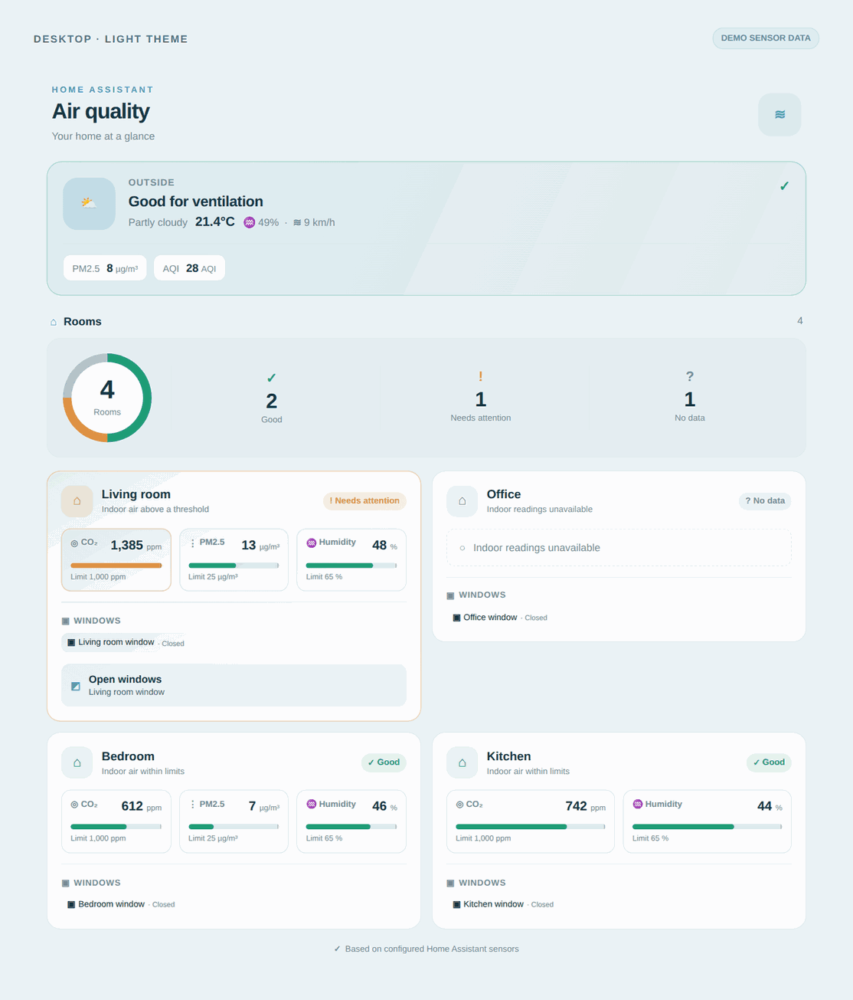
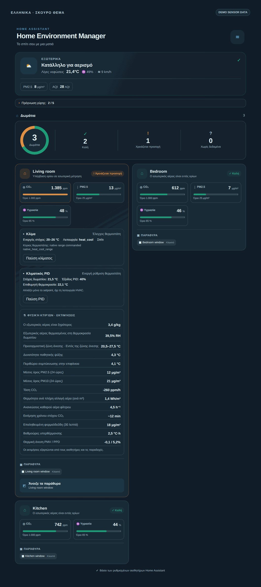
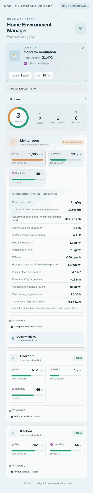
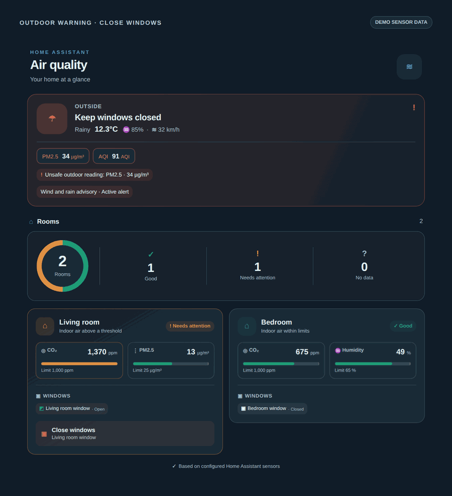

<p align="center">
  
</p>

<p align="center">
  <a href="https://ko-fi.com/chreece"></a>
</p>

<p align="center">
  <a href="https://github.com/Chreece/HA-Air-Quality-Advisor/releases"></a>
  <a href="https://github.com/Chreece/HA-Air-Quality-Advisor/actions/workflows/validate.yml"></a>
  <a href="https://www.hacs.xyz/"></a>
  <a href="https://github.com/Chreece/HA-Air-Quality-Advisor/blob/main/LICENSE"></a>
</p>

<p align="center">
  <a href="https://my.home-assistant.io/redirect/hacs_repository/?owner=Chreece&repository=HA-Air-Quality-Advisor&category=integration">
    
  </a>
</p>

# Air Quality Advisor for Home Assistant

**One recommendation entity and an optional visual dashboard card for all the rooms you select.** It compares indoor CO₂, AQI, particles, VOCs and humidity against outdoor air quality, current weather and selected weather-warning entities, then recommends **which windows to open or close and why**. Announcements are entirely optional.

> This project is an advisor, **not an automatic window actuator**, medical device, emergency warning system, or authoritative weather alert. It never controls covers. Outdoor warnings and uncertain conditions are intentionally treated as blockers.

<p align="center"></p>

## Dashboard screenshots

The examples below are **real renders of the bundled Lovelace card** using *sample sensor values*, not screenshots of a live Home Assistant installation. They demonstrate the available room summary, ventilation recommendations, outdoor warnings, responsive layout and Greek localization.

### Desktop overview — light theme

<p align="center">
  
</p>

### Greek localization — dark theme

<p align="center">
  
</p>

### Mobile view and outdoor warning

<table>
  <tr>
    <td align="center" width="38%"><b>Responsive mobile dashboard</b></td>
    <td align="center"><b>Unsafe outdoor conditions — close windows</b></td>
  </tr>
  <tr>
    <td valign="top" align="center"></td>
    <td valign="top" align="center"></td>
  </tr>
</table>

*Demo sensor values are illustrative; actual recommendations always use your configured Home Assistant entities. The card does not operate windows.*

Screenshots are generated with the bundled card source using [`tools/generate_readme_screenshots.py`](tools/generate_readme_screenshots.py). To refresh them after changing the card, run the one-time [README screenshots workflow](.github/workflows/readme-screenshots.yml) manually; it does not run on routine development pushes.

## What it provides

- A single `sensor.air_quality_advisor_window_recommendations` (actual entity ID may vary with user settings). States: `open`, `close`, `idle`, `blocked`.
- Attributes: `open_windows`, `close_windows`, structured `recommendations` with windows, room/area, sensor reason, value and localised message, `outside_blockers`, `diagnostics`, `outdoor_safe`, `announcement_hub_available`.
- Event-driven updates and periodic 5-minute freshness checks. No external APIs, daemons, cloud credentials or Home Assistant tokens. Uses existing entities only.
- A guided setup with editable, automatically suggested window exclusions, room selection, outdoor measurements and weather warnings. Indoor measurements and genuine window contacts are discovered using HA's entity/device area assignments. Configurable thresholds are tucked into **Configure → Advanced thresholds**.
- Optional room-aware [Announcement Hub](https://github.com/Chreece/HA-Announcement-Hub) output (`notify.announcement_hub`), **or** direct `notify.send_message` and `tts.speak` via supported entities. Not installing Announcement Hub does not affect the recommendation sensor.
- **One optional AI setting** for both delivery paths. With Announcement Hub configured, it explicitly forwards `use_ai: true/false` and optionally `ai_agent`; otherwise the selected Home Assistant conversation agent rewrites direct notification/TTS text. AI never changes the window decisions and is off by default. A stopped or rejecting Hub falls back to Home Assistant direct outputs or a persistent notification.
- Auto notifications/TTS can each be enabled or disabled independently. Open announcements wait 90 seconds for conditions to stay stable; close announcements are immediate. Repeated open recommendations have a 15-minute cooldown during the current HA process. New urgent close recommendations are not suppressed by that cooldown, even if the same window was reopened. No notification is generated on every unchanged sensor reading.
- Manual `air_quality_advisor.announce` action with an independent language override across **38 supported Home Assistant language choices**. Speech requires a compatible TTS voice.
- A responsive **Air Quality Advisor dashboard card**: safe/attention/unknown room counts, current outdoor weather and pollution, threshold meters, window states, and room-specific advice. Card text follows your **Home Assistant user language**, independently of voice/notification language.

## Installation

### HACS (versioned releases)

1. In HACS, open **Custom repositories**; enter `https://github.com/Chreece/HA-Air-Quality-Advisor` and choose **Integration**.
2. Install **Air Quality Advisor**, restart Home Assistant and add it under **Settings → Devices & services → Add integration**. The dashboard card is bundled and registered automatically when Home Assistant starts; no separate HACS frontend repository or copy to `www` is required.
3. No YAML configuration is required. After updating from a version that was classified as a Helper, **restart Home Assistant** so the new manifest type takes effect. The existing configuration and entity ID are kept; the integration should now appear under **Settings → Devices & services → Integrations** instead of being categorized under Helpers.

### Manual

Copy `custom_components/air_quality_advisor/` to `<your Home Assistant config>/custom_components/air_quality_advisor/`, restart HA, then add the integration from the UI. Alternatively, from the extracted repository run:

```bash
HA_CONFIG=/path/to/homeassistant/config bash ./install.sh
```

The installer writes **only** the integration directory, makes a rollback backup of an older installation and does not restart HA or end your SSH session.

## HACS releases

**v0.2.4 localization fixes are on `main` pending a manually launched release workflow.** They are not yet a published HACS update.

**Latest published stable release: [v0.2.2](https://github.com/Chreece/HA-Air-Quality-Advisor/releases/tag/v0.2.2)** · [Release notes](.github/releases/v0.2.2.md) · [Full changelog](CHANGELOG.md). The first published version was v0.1.8.

Install or update through the [HACS Integration repository](https://my.home-assistant.io/redirect/hacs_repository/?owner=Chreece&repository=HA-Air-Quality-Advisor&category=integration), select the versioned release, then restart Home Assistant. The Lovelace card is bundled; no separate card repository or `www` copy is required. Upgrades keep the same config entry and recommendation sensor unique ID.

GitHub Actions is **manual-only**: push all code and translations, then explicitly run **Validate and release (on demand)** from GitHub Actions. Leave **Publish release** unchecked for validation only, or enable it after all changes are committed to publish the new version after successful tests, HACS and Hassfest.

## Internationalization — 38 languages

Air Quality Advisor supports **38 Home Assistant language choices**, including 33 new locale packs for setup, reconfiguration, room states, notification messages, announcement text and the built-in dashboard card. The card follows the signed-in **Home Assistant user's language**, while `air_quality_advisor.announce` can override message language independently.

**Languages:** English, German, Greek, French, Spanish, Italian, Dutch, Portuguese (Portugal and Brazil), Polish, Russian, Ukrainian, Turkish, Czech, Slovak, Hungarian, Romanian, Bulgarian, Croatian, Serbian, Swedish, Norwegian Bokmål, Danish, Finnish, Indonesian, Vietnamese, Thai, Hindi, Simplified/Traditional Chinese, Japanese, Korean, Arabic, Hebrew, Persian, Bengali, Urdu and Tamil.

BCP47 support distinguishes `pt-BR` from `pt-PT`, and `zh-Hans` from `zh-Hant` (`zh-CN` and `zh-TW` are also recognized). Unsupported locales fall back to English. The dashboard uses right-to-left layout for Arabic, Hebrew, Persian and Urdu.

**Translation audit (v0.2.4):** All 38 language files now provide localized configuration and Reconfigure field labels, help text, validation errors, the settings-selection menu, abort messages, and the language selector's **Home Assistant default** option. Greek, German, French and Spanish include fully translated advanced-threshold labels and detailed explanations. The other 33 languages use short translated safety guidance and error messages with technical terms and symbols; native-speaker review is welcome. **Dynamic weather warnings, device names, room names, geographic names, sensor readings and IDs come from the user's Home Assistant or the weather provider and are not translated by this integration.** Actual spoken language still depends on the installed TTS voice.

Locale sources are in `custom_components/air_quality_advisor/locale_pack_*.py` and the reviewed, centralized `config_i18n_overrides.json` file. After editing either source, run `python generate_translations.py` and `python -m pytest -q tests/test_config_i18n_audit.py`. The generator applies the localized overrides **last**, so it cannot silently restore English helper text. Native-speaker improvements are welcome.

### Config-flow translation quality assurance

The full UI localization audit checks **all seven setup/Reconfigure sections**: Rooms, Window sensor exclusions, Per-room indoor sensors, Outdoor air, Weather/warnings, Announcements and Advanced thresholds. It also covers every helper description, every validation/abort message, the independent Options menu and dropdown option labels.

For example, the Greek Weather page explains directly that at least one weather provider is required, that unsafe weather prevents opening, and that active/unavailable warnings block opening. German, French, Spanish and the additional language packs receive corresponding localized instructions. [Audit details](TRANSLATION_AUDIT.md).

## Guided configuration and reconfiguration

**Initial setup** starts with Rooms, then window exclusions, followed by the remaining guided steps:

1. **Areas / rooms (multi-select).** Start by choosing which rooms to monitor. Rooms with Window-class `binary_sensor` contacts are suggested and automatically preselected. Window-class `cover` entities are never considered window contacts. You can remove unwanted rooms before continuing.
2. **Window sensor exclusions (multi-select).** Next, review recognized window contacts. Likely thermostat-derived or virtual window signals are preselected for exclusion; uncheck any actual window contacts or add other exclusions. If these exclusions remove the last usable contact from a selected room, setup returns to Rooms for review. If all contacts would be excluded, setup explains that at least one must remain. Your choices—including an explicitly empty exclusion list—are saved.
3. **Indoor air-quality exclusions (one page per selected room).** Each room with supported indoor sensors has its own multi-select. Available candidates include **humidity, CO₂, US AQI, PM2.5, PM10, total VOC mass concentration and VOC parts concentration**, using only the supported device classes or recognized sensor IDs with compatible units. Options show **device name › entity name · measurement · entity ID**; entities without a registered device still show entity name, metric and ID. Select sensors to **exclude** from that specific room; **leave empty to monitor them all**. On reconfiguration the saved exclusions are checked. Previously excluded but now missing sensors remain selectable, so you can remove obsolete exclusions. Rooms without supported indoor sensors are skipped rather than showing a useless blank menu.
4. **Outdoor air quality.** Select recognized outdoor entities not associated with monitored rooms. Unknown, unavailable and stale readings are reported as missing, not treated as dangerous. Valid high readings still block opening.
5. **Weather and warnings.** Select one or more `weather.*` entities and optional recognized warning sensors. Unsafe weather and active or unknown warnings block window opening.
6. **Announcements (optional).** Configure spoken/visual delivery, language and optional [Announcement Hub](https://github.com/Chreece/HA-Announcement-Hub) routing. Advanced thresholds are edited separately through Configure.

Indoor exclusions are stored **by Home Assistant area**, used for both recommendations and the dashboard snapshot. An excluded indoor sensor remains available in Home Assistant; the integration does not disable, delete or modify it. Areas with no remaining active indoor measurements are shown as **unknown**, never silently marked safe. Only the single existing window-recommendation entity is generated.

For an installed integration, open **Settings → Devices & services → Integrations → Air Quality Advisor → Configure**. A translated menu lets you choose exactly which section to edit: Rooms, Window sensor exclusions, Per-room indoor air sensors, Outdoor air sensors, Weather and warnings, Announcements, or Advanced thresholds. Only the selected section opens. Indoor sensor exclusions continue room by room, but every other section saves immediately without forcing the rest of setup. Your saved selections are prefilled; cancelling leaves existing settings unchanged. The full flow uses the same five Home Assistant UI languages (English, German, Greek, French and Spanish).

### Supported indoor and outdoor measurements

| Measurement | Supported unit(s) | Outdoor good at or below | Indoor requires ventilation at or above |
|---|---|---:|---:|
| AQI — **US scale 0–500** | index / none / AQI | 50 | 100 |
| CO₂ | ppm | 800 | 1,000 |
| PM2.5 | µg/m³ or mg/m³ | 15 | 25 |
| PM10 | µg/m³ or mg/m³ | 45 | 45 |
| Total VOC | µg/m³ or mg/m³ | 500 | 500 |
| VOC concentration (parts) | ppb or ppm | 500 ppb | 500 ppb |
| Relative humidity | % | — | 65% |

Sensor values are normalised to the units above. Outdoor temperatures from weather entities must remain from **5–32 °C**, humidity at most **85%** and wind at most **35 km/h** when those attributes are provided. Supported fair weather states: `sunny`, `clear-night`, `partlycloudy`, `cloudy`. All other states, including rain, snow, thunderstorms, fog and high wind, block opening. Selected warnings that are active **or cannot be verified** also block opening. Weather providers with unknown state block opening. Selected outdoor data older than 90 minutes (using `last_reported` when available) are reported as unavailable, without blocking opening. Adjust the freshness interval by checking **Edit advanced thresholds** on the announcements page.

**AQI scales differ internationally.** A European 1–5 index is *not* the US 0–500 AQI. For 1–5 index sensors, change the outdoor AQI limit (for example `2`) and indoor AQI trigger (for example `3`) using **Edit advanced thresholds**, or use the measured pollutant sensors instead. Numeric thresholds are configurable per installation, not per sensor, and do not represent exposure-duration standards.

### Decision policy

| Outdoor state | Indoor state and windows | Recommendation |
|---|---|---|
| Good, no selected warnings | Indoor CO₂/particles/VOC/AQI/humidity exceed a threshold and all room windows are closed | **Open** the room's recognized windows, with the measured reason |
| Bad, rainy, extreme, warning active or unknown | Any recognized window is actually open | **Close** each open window, with outdoor blocker(s) |
| Good | Room already has a window open | No further open action (ventilation already underway) |
| Good | Indoor values acceptable | `idle` |
| Missing weather or unknown weather-warning status | No windows verified open | `blocked`; no open recommendation |
| An outside air-quality sensor is unknown/unavailable | Otherwise good known conditions | No blocker from that sensor; diagnostics show missing data |
| No room sensor or window contact | Missing information | No guessed recommendation; diagnostics attribute identifies the gap |

Only **non-excluded** `binary_sensor` entities with device class `window` count as windows. A `cover` is never counted, even if its device class is `window`. Excluded entities are ignored by room suggestions, window counts, open/close recommendations, automatic announcements, and the dashboard. The automatic suggestions are based on entity and device metadata, **not a guaranteed physical-contact identification**; review them for your hardware. Missing outside readings do not themselves block opening/require closure, but appear in `unavailable_outdoor_sensors` and set `outdoor_data_complete: false`. Missing weather or an unknown weather-warning status still blocks opening.

## Air Quality Advisor dashboard card

<p align="center"></p>

**Add it from the dashboard card picker**: Edit your dashboard → **Add card** → **Air Quality Advisor**. The integration registers the card JavaScript automatically after a Home Assistant restart, and the card discovers the recommendation sensor if you have exactly one Air Quality Advisor instance. The card picker also suggests it for your recommendation entity. A built-in graphical editor lets you select the sensor, rename the card and toggle the outdoor panel and detailed metrics.

The equivalent YAML is:

```yaml
type: custom:air-quality-advisor-card
# Optional when exactly one Air Quality Advisor integration exists:
entity: sensor.air_quality_advisor_window_recommendations
# Optional card settings:
show_outside: true
show_metrics: true
```

Use the actual entity ID from **Developer tools → States** if it differs from the example. The card reads `attributes.dashboard` from the integration's **single existing recommendation sensor**; it creates **no additional entities** and never controls windows. It works in Sections and masonry dashboards, light/dark themes, phones and desktop. It shows:

- An **outdoor status panel** with the current weather, temperature, wind, humidity, selected outdoor pollution readings and warnings. *Unsafe* means a known hazard; *unknown* means required weather/warning information is missing; *partial* means a selected air sensor is unavailable even though available readings do not block ventilation.
- A **donut chart and totals** for rooms marked **Good**, **Needs attention** and **No data**. Rooms with high indoor pollutants, or an urgent close-window recommendation, require attention. Rooms with missing measurements or unknown window contacts are never counted as good. Already-open windows with bad indoor air remain visible as requiring attention.
- **Room panels** with CO₂/PM/AQI/VOC/humidity gauges against the thresholds in your integration settings, plus actual window contacts and open/close recommendations. Extra readings can be expanded without leaving the dashboard.

The card automatically uses **Home Assistant's per-user interface language** (`hass.language`), not the separately configured announcement language. It includes native text for English, German, Greek, French, Spanish, Italian, Dutch, Portuguese, Polish, Russian and Turkish; unsupported languages fall back to English. Sensor names and room names remain as named in Home Assistant.

If the card doesn't appear after updating via HACS, **restart Home Assistant**, reload the browser and reopen the card picker. It also exposes a normal JS resource endpoint at `/air_quality_advisor/air-quality-advisor-card.js` for installations where automatic frontend loading has been disabled; there is no need to copy it to `/config/www`.

## The one sensor

<p align="center"></p>

Typical state when CO₂ is high but outdoor air and weather are good:

```yaml
state: open
attributes:
  outdoor_safe: true
  outdoor_data_complete: true
  unavailable_outdoor_sensors: []
  open_windows:
    - binary_sensor.living_room_window
  close_windows: []
  recommendations:
    - action: open
      area_id: living_room
      area: Living room
      windows:
        - binary_sensor.living_room_window
      reasons:
        - code: inside_co2
          entity: Living room CO₂
          value: 1,200 ppm
      message: "Open Living room window in Living room: Living room CO₂ is high (1,200 ppm). Outdoor conditions are suitable."
```

The system automatically updates this entity. You can display `recommendations`, `open_windows`, `close_windows` and `outside_blockers` in dashboards or automations. No duplicate per-area sensors.

## Repeating persistent window recommendations (v0.2.3 — awaiting manual release)

Under **Air Quality Advisor → Configure → Announcements**, set **Repeat announcements (minutes)** to any whole number from **0 to 1440**. The default is **10 minutes** for new and existing installations; **0 means never repeat**. This applies only if automatic notifications or automatic TTS are enabled. Manually invoked announcements are not scheduled for repetition.

- A **new open-window** recommendation still waits 90 seconds for stable conditions; a **close-window** recommendation is announced immediately. Repeats run at the configured interval **after the previous automatic submission finishes**, so slower AI/Hub calls do not cause overlapping reminders.
- A reminder is sent only while **the same room, window action and cause remain actionable**. Before each reminder, the sensors and window contacts are checked again. When the window is opened/closed or air/weather conditions recover, remaining timers are cancelled.
- Each monitored **room has its own reminder timer**. A CO₂ value fluctuating above its threshold does not reset the timer, but a different sensor reason or weather category starts a fresh interval. The existing 15-minute anti-flapping cooldown applies only to newly reappearing open-window recommendations; it **does not block timed reminders**.
- On Home Assistant restart, an already-urgent close recommendation still announces immediately; an existing open recommendation receives its first reminder after one full repeat interval rather than immediately on boot.

The setting works with Announcement Hub, direct TTS, native notification entities and persistent Home Assistant notifications. It does not alter pollutant thresholds, AI permissions or actual window control.

## AI-enhanced announcements and fallback

Open **Air Quality Advisor → Configure → Announcements**. **Use AI for announcements** is a single checkbox for both routes, off by default. The automatic notification and TTS switches still independently control whether anything is announced. Existing saved AI settings are preserved during upgrades.

- **Announcement Hub selected:** This checkbox sends an explicit `use_ai: true` (or `use_ai: false` when unchecked) with the room-specific `notify.announcement_hub` action. A custom conversation agent is forwarded as `ai_agent`; leaving **Home Assistant default** selected omits the field so the Hub uses its own configured agent. The Hub performs the rewriting and controls delivery; the advisor does not rewrite the same message again.
- **Announcement Hub not selected:** The advisor uses `conversation.process` to rewrite the original text before sending it to direct `notify.send_message` and/or `tts.speak` outputs. The agent choice defaults to Home Assistant's default conversation agent; other `conversation.*` entities can be selected. Failed or invalid rewrites use the unchanged original message (up to eight seconds for opening and three seconds for urgent closing recommendations).

**When the Hub option appears:** It is offered **only if Announcement Hub has a Home Assistant configuration entry**. Merely having an action named `notify.announcement_hub` is not enough. If that integration is removed, unconfigured, stopped or not loaded, or a Hub call is rejected, times out or returns no eligible route, the advisor bypasses the Hub and tries direct Home Assistant outputs. The submission is awaited so a rejection can actually be detected.

**Fallback order:** configured `notify.send_message` outputs and/or `tts.speak` engines/players → built-in `persistent_notification.create` (one updated notification per room) if nothing was delivered. Selecting fallback outputs is recommended if you need audible fallback: a persistent notification is **visual only** and cannot provide spoken TTS without a configured speaker/engine. If no fallback service is available, the manual action reports a delivery error. Once the Hub **accepts a queued job**, its later output retries remain its own responsibility; the advisor does not issue duplicate notifications for downstream speaker failures.

**AI safeguards and privacy:** Window/room selection, weather limits, sensor reasons and alert timing stay deterministic. The advisor validates direct AI text to preserve the action, room, window names and measurements; failures fall back to the original message. Home Assistant conversation agents can have device-control privileges and may execute tools even when asked to rewrite text only. Use a text-only/low-permission agent, and review cloud-agent data sharing (room and window names and sensor readings can leave your Home Assistant). The built-in non-generative Assist agent may not rephrase arbitrary text.

## Announcing in a different language on each action

```yaml
action: air_quality_advisor.announce
data:
  language: el  # any supported locale, e.g. el, de or pt-BR
  channels: both  # both, tts, notification
  areas:
    - living_room
```

Omit `areas` to report every room with an actionable recommendation. The manual action can be called even when automatic TTS/notifications are disabled. Passing `language` changes the **generated recommendation text** and requests the matching speech language. Actual spoken voice availability depends on the selected TTS provider. The service may report accepted/submitted requests; this does not guarantee a physical speaker played audio or a notification was displayed.

Announcement Hub delivery uses the established action:

```yaml
action: notify.announcement_hub
data:
  text_notify: "...localized room recommendation..."
  text_tts: "...localized room recommendation..."
  output:
    - living_room
  level: warning
  occupied_only: false
```

This integration emits that action automatically when enabled. Explicit room routing is intentionally not filtered by occupancy; messages about windows needing to be closed must be able to reach the room's configured outputs. If the Hub action is missing or rejects a submission, explicit standalone notification/TTS outputs can be used instead.

## Testing, validation, and publishing

```bash
python -m pytest -q tests
python -m compileall -q custom_components
bash ./publish.sh
```

`publish.sh` requires a previously authenticated GitHub CLI (`gh auth status`) and creates `Chreece/HA-Air-Quality-Advisor` if absent. It **never force-pushes** or mutates other repositories. **GitHub Actions is now manual-only.** Finish and push all code, translations and release notes first, then choose [Actions → Validate and release (on demand) → Run workflow](https://github.com/Chreece/HA-Air-Quality-Advisor/actions/workflows/validate.yml) on `main`. The default run validates without publishing; enable **Publish release** to create the versioned HACS release *after* all checks pass. Neither pushes nor changes to `.github/release-request.json` start any action. See [RELEASING.md](RELEASING.md).

## Known limitations

- Only the named supported metric/device classes and units are interpreted. Unrecognized AQI variants, CO/ozone/NO₂/SO₂, arbitrary provider attributes and event-based weather alerts are not guessed at. Add a normalized HA template sensor where necessary.
- The thresholds apply to individual current readings, rather than averaging over standardized pollutant exposure windows. Relative humidity alone does not account for absolute outdoor humidity; the advice is a useful home automation signal, not a guaranteed best ventilation strategy.
- Advisory window names/rooms depend on HA registry assignments. If window contacts are missing, a recommendation cannot name a window.
- Direct TTS is a standard `tts.speak` call and may interrupt the chosen media player; use Announcement Hub for its queued/synchronized room audio policies.
- Dynamic Home Assistant environment tests (config flow and live TTS/notifications) require a Home Assistant instance; the included automated tests cover the pure policy, not all integrations/providers.

## License

MIT © 2026 Chreece

## Project status, compatibility and releases

- **Home Assistant 2026.10+**; modern UI config/options flow and a bundled Lovelace dashboard card. The component ships local `custom_components/air_quality_advisor/brand/` assets for Home Assistant 2026.3+ as well as repository-level HACS assets.
- **HACS custom integration repository:** `hacs.json`, `manifest.json` and conventional `custom_components/` layout are included. Public HACS catalog inclusion is a separate community-review process.
- **Validations:** `pytest`, static syntax checks, JSON checks, HACS action and hassfest are available in a manually triggered GitHub workflow. Actual platform compatibility and output delivery require a Home Assistant integration test; see the [release checklist](RELEASING.md).
- **Versions:** see [CHANGELOG.md](CHANGELOG.md). This release is a first testable version, not an independently verified stable integration. No automatic window opening/closing is performed.

## Support this project

If this integration helps, you can support ongoing development on [Ko-fi](https://ko-fi.com/chreece). Contributions and bug reports are welcome through the repository's [issues](https://github.com/Chreece/HA-Air-Quality-Advisor/issues).
